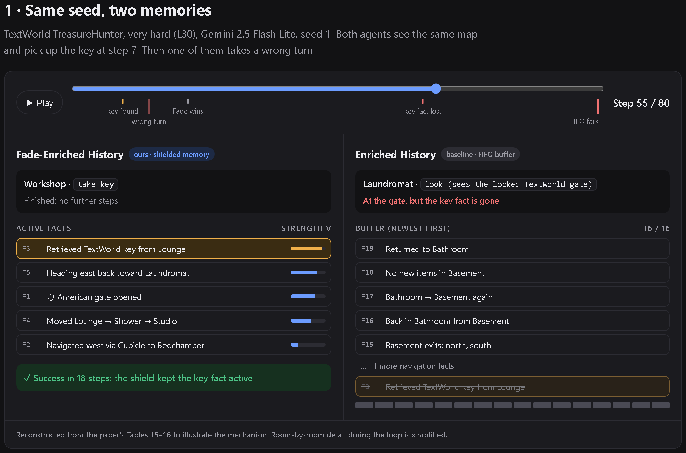
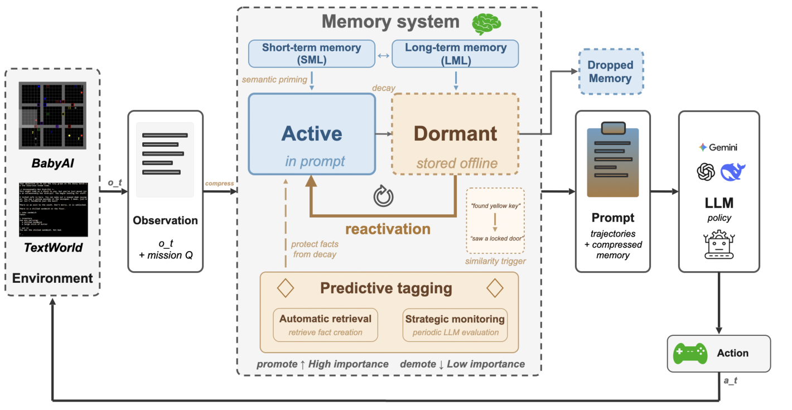

<div align="center">

# 🧠 Adaptive Memory for Sparse Embodied LLM Agents

**Fact Compression · Predictive Shielding · Dormant Reactivation**

*What should an LLM agent remember when the key clue appears once, and only matters 20 steps later?*

[](https://cyrchanh.github.io/open-endedness-project/)
[](Group5_OEGI_paper.pdf)


</div>

---

## TL;DR

Most LLM memory systems are built for **chat**, where important facts come up again and again, so "how often was this mentioned?" works as a proxy for importance. **Embodied agents don't get that signal.** In a text game, you might see a key once in room 2 and find the locked door in room 14.

We took **[FadeMem](https://arxiv.org/abs/2601.18642)**, a decay-based memory architecture built for conversational QA, and adapted it for sparse, sequential decision-making with three new mechanisms:

| | Mechanism | What it does | Inspired by |
|---|---|---|---|
| 🗜️ | **Trajectory to fact compression** | Every 3 steps, an LLM condenses the last 3 (observation, action) pairs into one standalone, mission-anchored fact | Semantic memory |
| 🛡️ | **Predictive shielding** | Tags facts that will *probably* matter later (e.g. *"picked up blue key"* means a *"locked blue door"* is coming) and freezes their decay until the trigger appears | Prospective memory (McDaniel & Einstein, 2000) |
| 💤 | **Dormant reactivation** | Weak facts leave the prompt but aren't deleted. When the current observation is similar enough, they come back | Silent engrams (Josselyn & Tonegawa, 2020) |

We then ran a full benchmark: **6 memory conditions × 3 environments × 3 LLM backbones × 30 seeded episodes per cell**, reported with Wilson 95% confidence intervals.

## ▶ Interactive demo

**[cyrchanh.github.io/open-endedness-project](https://cyrchanh.github.io/open-endedness-project/)**: step through the same seeded episode under both memory designs, watch a shielded fact survive, and compare results across models. No install or API keys needed.

<a href="https://cyrchanh.github.io/open-endedness-project/"></a>

## 🏗️ Architecture

<p align="center">
  
</p>

Each fact has a strength `v ∈ [0, 1]` that decays exponentially, at a rate set by its importance (mission relevance, access frequency, recency) and its memory layer (short-term vs. long-term):

```
active   (v ≥ 0.15)          → in the prompt
dormant  (0.05 ≤ v < 0.15)   → hidden, but can be reactivated by similar observations
dropped  (v < 0.05)          → purged
```

On top of that: LLM-guided conflict resolution (compatible / contradictory / subsumes / subsumed) with a rule-based fast path for obvious state changes like *locked → unlocked*, semantic fusion of near-duplicate facts, and semantic priming of weak facts. Full equations and all 30 hyperparameters are in the [paper](Group5_OEGI_paper.pdf) (Section 3, Appendices A to G).

## 📊 Key results

### 1. Memory matters a lot, and both kinds help

Success rate (%) on **TextWorld TreasureHunter, hard (L20)**:

| Condition | GPT-4o-mini | Gemini 2.5 Flash Lite | DeepSeek Chat |
|---|:-:|:-:|:-:|
| No memory (baseline) | 17 | 23 | 37 |
| Cross-episode reflection | 23 | 27 | 33 |
| Compressed facts only | 30 | 67 | 67 |
| Raw trajectory | 67 | 87 | **97** |
| Trajectory + facts | 63 | 93 | **97** |
| **Ours: Fade-Enriched History** | **70** | **97** | **97** |

Raw history and compressed facts **each** give large gains over a memoryless agent, often 3 to 4×. Reflection-style lessons from past episodes barely help, because the layouts are procedurally generated and change every episode.

### 2. Dynamic memory helps only under specific conditions

The most useful finding was **when** adaptive memory pays off, not just whether it does. It beat a plain FIFO memory only when **all four** of these held:

| # | Condition | Evidence |
|:-:|---|---|
| 1 | **Episodes are long enough** | On easy levels, GPT solves tasks in 4 to 8 steps, before the 12-step tagging cycle ever runs |
| 2 | **Information is acquired long before it's used** | On CoinCollector (no key/lock dependencies), shields never fire and there is no gain |
| 3 | **The backbone is in the "sweet spot"** | GPT-4o-mini misclassifies its own facts as contradictory and erases good memories. DeepSeek is strong enough that raw context is enough. Gemini benefits most (83% vs 77% on L30) |
| 4 | **The agent can do the basic task** | On BabyAI, 60 to 100% loop rates show the bottleneck is spatial reasoning, not memory |

### 3. Why it works: a same-seed case study

Same seed, same map, same model (Gemini, L30). Both agents pick up a key at step 7.

- **FIFO memory:** a wrong turn at step 11 causes a 40-step detour. Navigation facts fill the 16-slot buffer and **push out "I have the key"**. The agent reaches the locked gate at step 55, doesn't remember the key, and fails.
- **Ours:** the key fact is **shielded** with trigger `locked.*(gate|chest)`, so it stays in memory however long the detour is. The agent unlocks the gate and **succeeds in 18 steps.**

> The value of dynamic memory is not preventing mistakes. It is **preventing cascading information loss when mistakes happen.**

The annotated reasoning traces (predictive tagging in action, BabyAI loop failures, GPT-4o-mini conflict-classification errors) are in Appendix M of the paper.

## ⚙️ What's in this repo

A modular, config-driven experiment harness for running LLM agents in text environments.

```
├── agent/base.py              # Memory-augmented agent: all 6 memory conditions, decay,
│                              #   shielding, reactivation, conflict resolution, fusion
├── llm_clients/               # Provider-agnostic clients (OpenAI, Gemini, DeepSeek)
│                              #   with structured JSON output parsing
├── prompt_builder/            # Hybrid prompt: trajectory ring buffer + ranked fact block
├── environments/              # Env wrappers with valid-action handling and fallbacks
├── babyai_text/               # Text-ified BabyAI (grid → natural-language observations)
├── evaluator.py               # BabyAI runner (single run or full grid)
├── evaluator_textworld.py     # TextWorld TreasureHunter runner, with reasoning-trace logging
├── coin_collector_exp/        # Parallel multi-provider batch runner for CoinCollector
├── postprocess_rollouts.py    # Metrics: success rate, Wilson CIs, loop rate, blocked-forward rate
├── config/                    # OmegaConf YAMLs for every experiment
├── docs/                      # Interactive demo (GitHub Pages)
└── Group5_OEGI_paper.pdf      # Full paper
```

**Engineering highlights**

- **One switch for 6 memory conditions:** `baseline`, `trajectory`, `reflection`, `enriched`, `enriched_history`, `fade_enriched_history`, all selected by one config key so the comparisons are controlled
- **Swappable LLM backends** behind a common client interface, with JSON-mode parsing and fallback actions for invalid outputs
- **Reproducible grids:** seeded procedural environments, batch mode across every (task × memory × model) cell, JSONL rollouts
- **Built-in observability:** `--trace` logs per-step memory snapshots, fact strengths, trigger firings and conflict decisions, which is what made the failure analysis possible
- **Cost control:** a rule-based conflict fast path and capped LLM classification calls per new fact cut down API usage
- **Behavioural diagnostics:** automatic loop detection (repeated streaks and A-B-A-B oscillation) and blocked-movement tracking

## 🚀 Quick start

```bash
# 1. Environment (Python 3.10)
conda create -n fade-mem python=3.10 -y && conda activate fade-mem
pip install -r requirements.txt
```

> **Note:** TextWorld requires Linux or macOS. On Windows, use WSL.

```bash
# 2. API keys: create a .env file in the project root
OPENAI_API_KEY=...
GEMINI_API_KEY=...
DEEPSEEK_API_KEY=...
```

**BabyAI** (settings in `config/config.yaml`)
```bash
python evaluator.py            # single run
python evaluator.py --batch    # all memory types × all tasks
```

**TextWorld TreasureHunter** (settings in `config/config_textworld.yaml`)
```bash
python evaluator_textworld.py --difficulty easy              # easy | medium | hard | very-hard | all
python evaluator_textworld.py --difficulty hard --trace       # with per-step memory traces
python evaluator_textworld.py --batch                        # all difficulties × memory types
python evaluator_textworld.py --difficulty hard --max-steps 200 --num-episodes 20
```

**TextWorld CoinCollector** (settings in `coin_collector_exp/config/coin_collector.yaml`)
```bash
cd coin_collector_exp
python run_tw_batch.py                                       # full grid, providers run in parallel
python run_tw_batch.py --levels L1,L5,L10 --memory-types baseline,trajectory --providers openai --workers 4
```

To switch models, change `llm.provider` (`openai` | `gemini` | `deepseek`) and `llm.name` in the config. To switch memory designs, change `agent.params.memory_type`.

## ⚠️ Limitations

We report these plainly:
- **30 episodes per cell** (limited by API cost), so confidence intervals are wide and many top-tier differences overlap
- Fade is evaluated **as a whole system**; the individual mechanisms were not ablated one by one
- All three backbones are lightweight models. Stronger models may move the "sweet spot"
- BabyAI results are limited by text-only spatial reasoning rather than by memory

## 👥 Team & my role

This was a **UCL MSc Machine Learning group research project** (Open-Endedness & General Intelligence module, Group 5) with six contributors, **awarded a Distinction**. See the [contributors graph](https://github.com/cyrchanh/open-endedness-project/graphs/contributors).

**My contribution ([@cyrchanh](https://github.com/cyrchanh)):**
- **Research direction:** proposed the project topic and steered the group towards it, adapting chat-focused memory such as FadeMem to sparse embodied agents
- **TextWorld experiments:** ran the TreasureHunter experiments across the memory conditions, difficulty levels and LLM backbones
- **Analysis:** analysed the results and drew out the insights behind the paper's conclusions, including when dynamic memory helps and when it doesn't

## 📚 Citation

```bibtex
@misc{group5_2026_adaptivememory,
  title  = {Fact Compression, Predictive Shielding, and Dormant Reactivation:
            Adaptive Memory for Sparse Embodied LLM Agents},
  author = {{Group 5}},
  year   = {2026},
  note   = {UCL MSc Machine Learning, Open-Endedness and General Intelligence group project},
  url    = {https://github.com/cyrchanh/open-endedness-project}
}
```

Builds on [FadeMem](https://arxiv.org/abs/2601.18642) (Wei et al., 2026), [BALROG](https://github.com/balrog-ai/BALROG), [TextWorld](https://github.com/microsoft/TextWorld) and [BabyAI / MiniGrid](https://github.com/Farama-Foundation/Minigrid).
